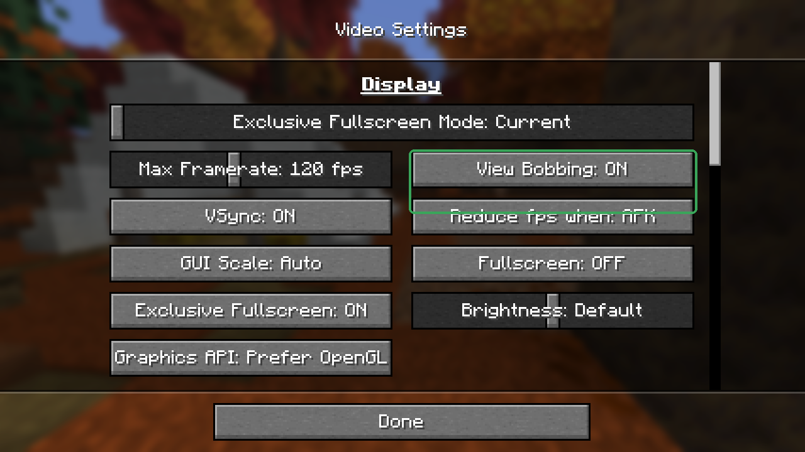

# View Bobbing Back


Minecraft moved **View Bobbing** out of Video Settings and into Accessibility Settings. This mod moves it back.



## What it does

- Adds `View Bobbing` to **Options > Video Settings**, in the first row of the Display section, right column.
- Removes it from **Accessibility Settings**, so it is not in two places.
- Uses the same vanilla option, so the value you already set carries over.


## Sodium support

Sodium replaces the Video Settings screen with its own, so the vanilla hook never shows up there. This mod also registers the same option through Sodium's Config API, on the **General** page.

Sodium's API only appends, so the option lands at the end of General. Typing `bobbing` into Sodium's search box jumps straight to it.


## Why

It is the first setting people reach for when they get motion sick, and it is a setting PvP players flip constantly. Two menus and a scroll is too far for that.

## Install

1. Install [Fabric Loader](https://fabricmc.net/use/installer) for Minecraft 26.1 or newer.
2. Drop the jar into `.minecraft/mods`.
3. Launch the `fabric-loader` profile.

Client side only. Works in singleplayer and on any server.

## Compatibility

All versions below were launched with the jar installed and checked in memory: the option sits at index 1 of the video list and the Accessibility entry is gone.

| Version | Vanilla | Sodium |
|---|---|---|
| 26.3 | tested | tested (0.9.2) |
| 26.2 | tested | - |
| 26.1.2 | tested | - |
| 26.1.1 | tested | - |
| 26.1 | tested | - |
| 1.21.11 | tested | 0.8.x hook |
| 1.21.10 | tested | 0.7.x hook |
| 1.21.9 | tested | 0.7.x hook |

Sodium hooks are soft-targeted: if a Sodium build renames the hook, the option stays in Accessibility instead of disappearing.

## Build

No Gradle. The game jar ships with real Mojang names, so the mod compiles straight against it.

```bash
./build.sh
```

`build.sh` expects:
- a JDK of the game's class file version (26.x is Java 25),
- the game jar at `.minecraft/versions/<ver>/<ver>.jar`,
- `libs/sponge-mixin-*.jar`, `libs/mixinextras-fabric-*.jar`, `libs/fabric-loader-*.jar` on the compile classpath.

Output: `build/viewbobbing-back-<version>.jar`.

## How it works

Three mixins, all on array or builder returns rather than `init()`:

- `AccessibilityOptionsScreenMixin` filters `options.bobView()` out of `AccessibilityOptionsScreen.options(Options)`.
- `VideoSettingsScreenMixin` inserts `options.bobView()` at index 1 of `VideoSettingsScreen.displayOptions(Options)`, which is the right column of the first row.
- `SodiumConfigBuilderMixin` (soft target, `@Pseudo`) appends a boolean option to Sodium's `SodiumConfigBuilder.buildGeneralPage(...)`, bound to the same `options.bobView()` value.

The Sodium mixin lives in its own config with `required: false` and `defaultRequire: 0`, so a Sodium update that renames the method logs a warning instead of crashing the game.

## License

MIT, see [LICENSE](LICENSE).
